# The document composer

The composer is where a document is written: a certificate, a pre-approval, a prescription, a letter. You choose a
type and a patient, fill in the values the type asks for, pick and edit its prepared sentences, add your own text, and
check the result in a PDF preview. When the document is ready, the doctor issues it: it gets its DocArc code and QR
code, is archived in DocArc, and can no longer change.

- **Documents** in the top bar lists every document (`/documents`).
- The **doctor** and the **secretary** both write documents. Only the doctor issues, withdraws and rebuilds them
  (section 11).
- What a document *can* say (its sections, sentences, values and case features) comes from its **type**, which is
  edited in the type editor (`docs/type-editor.md`). A document keeps the type version it was created with.

The screenshots use an invented patient («Δοκιμαστική Ασθενής») and three types: `vevaiosi-mri` (MRI compatibility
certificate), `proegkrisi` (surgery pre-approval, with a case feature) and `syntagi` (prescription).

---

## 1. The documents list

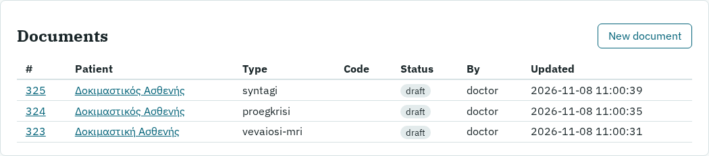

The latest 200 documents, most recently changed first, with:

- the patient;
- the type;
- the DocArc code (once one is reserved);
- the **status**;
- who created the document;
- when it last changed.

Click the number or the patient to open a document. **New document** starts one.

The statuses, in the order a document goes through them:

| Status | Meaning |
| --- | --- |
| `draft` | Being written. Anyone can edit it. |
| `review` | The secretary marked it **Ready for review** for the doctor. It can still be edited. |
| `code_reserved` | The doctor asked DocArc for a code. The text can still be edited and the code stays. |
| `final_compiled` | The final PDF (with the real QR) is built and waits for the doctor's approval. |
| `approved`, `pdf_sent` | Approved and frozen, but not yet completely sent to DocArc (section 11 shows how to finish). |
| `issued` | In DocArc. It can no longer change. |
| `withdrawn` | Taken back by the doctor (a mistake such as the wrong patient). DocArc has deleted its record. |

---

## 2. A new document

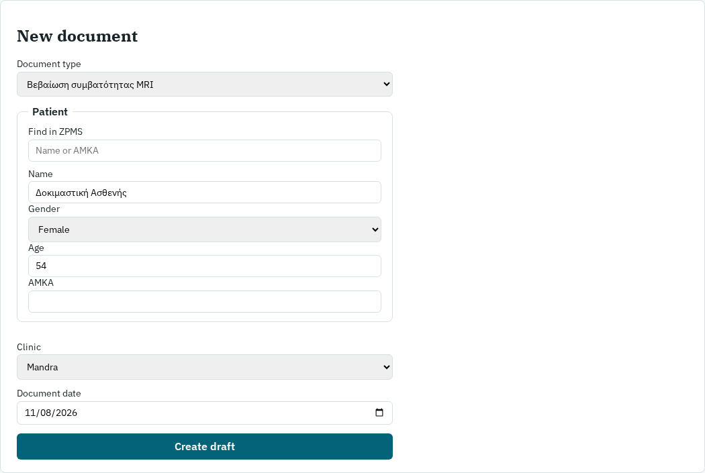

1. **Document type:** the types that have a released version. The document uses the latest released version from now
   on, even after the type changes.
2. **Patient:**
   - **Find in ZPMS:** type at least two letters of the name, or the AMKA, and pick the patient. The name, gender,
     AMKA and date of birth are copied in; the age is worked out at the document date. "From ZPMS: … Clear" shows the
     link.
   - **By hand:** type the details yourself. This also works for every type, and when ZPMS is not reachable.
   - **Gender** matters: the Greek text agrees with it (ο/η ασθενής). A document without it cannot be issued.
   - Types with no patient (price list, leaflet) still show these boxes; a name is not required for them.
3. **Clinic** sets the letterhead (logo, address, phone).
4. **Document date** is printed on the document. Today is the default.
5. **Create draft** opens the composer.

The new document starts with the type's default choices, and with its default medication rows if it has any.

---

## 3. The composer page

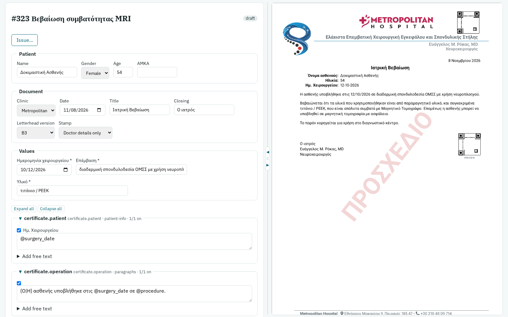

- **Left:** the form, from top to bottom: the header, the patient, the document settings, the values, case features,
  the sections, and the buttons.
- **Right:** the latest **preview** PDF (section 9). Next to it are the "Print two A5 per A4 sheet" links, for A5
  documents only.
- **The splitter** between them works like the type editor's: drag it, or use ◀ / ▶ (form only → both → preview
  only).
- **The header:** the document's number, its type and its status.
  - **Issue…** (doctor only) opens the issue page; once the document is locked, the button is called **Issue page**.
  - **History** appears once the document is issued.

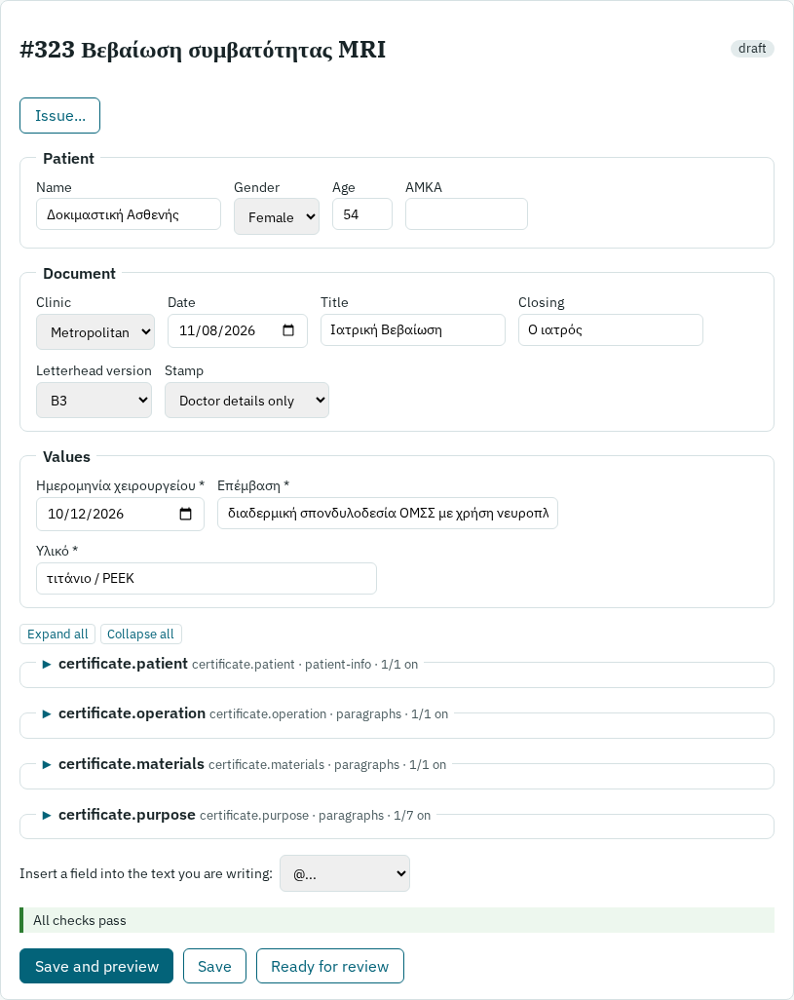

### Patient

What will be printed. A patient taken from ZPMS says "from ZPMS; changes here stay on this document only": correcting
a name or the age here never changes ZPMS.

### Document

- **Clinic** and **Date**, as on the new-document form.
- **Title** (e.g. «Ιατρική Βεβαίωση») and **Closing** (e.g. «Ο ιατρός»): the type's defaults. Clicking in the box
  offers the type's other titles and closings, and you can type anything. An empty closing prints no doctor block.
- **Letterhead version:** B1, B2, … are versions of the letterhead files (logos, doctor details, layout). A document
  keeps the one it was made with. Change it only on purpose, before the code is reserved.
- **Recipient** (only for types that have one): the line naming who the letter is for.
- **Stamp:** "Doctor details only", or "Signature and stamp" (the stamp image under the closing).

### Values

The type's fields: dates, the procedure, the material… Fields marked * are required. A value appears everywhere its
`@field` is used in the text. Dates are typed in the date box; how they are printed (12/10/2026, 12-10-2026 or 12
Οκτωβρίου 2026) is set by the type.

---

## 4. Sections

The body of the document is a list of **sections**, in print order. Each one is a box whose title line shows:

- the section's name: its label, else its heading, else its slot;
- grey: the slot (where its text is stored for suggestions) and the layout (`paragraphs`, `itemize`, `topics`,
  `patient-info`, `medtable`, …);
- how many of its sentences are on (`1/7 on`), or how many rows a medication table has.

**Folding.** Click the title line, or press Enter on it, to fold or open a section. **Expand all** / **Collapse all**
work on every section. A section starts folded when nothing in it is chosen, and it has no free text and no medication
rows. An optional section that is switched off also starts folded. Folding only changes the screen, never the
document.

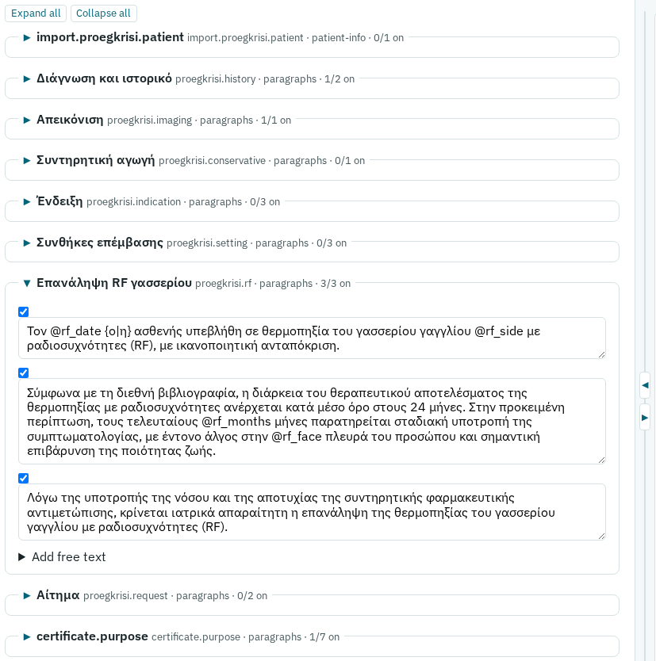

### Sentences

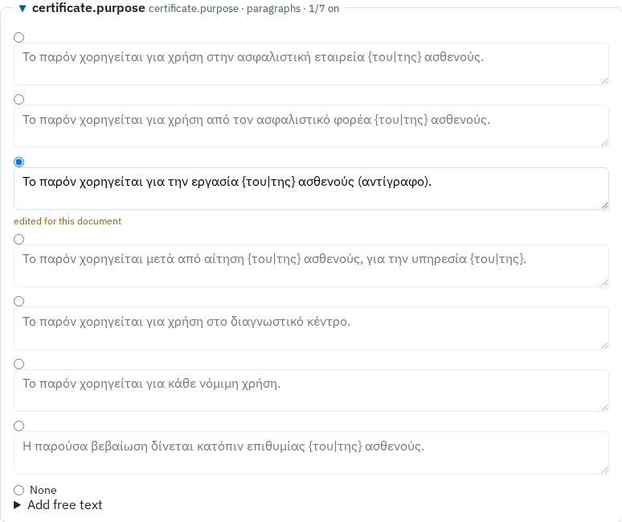

- **A checkbox** sentence is printed when ticked.
- **A choice group** (round buttons) prints *one* of its sentences. **None** prints none of them. The seven "purpose"
  sentences above are a group.
- **Editing a sentence:** change its text in its box. The change is for this document only: the box says "edited for
  this document" and the type is not touched. To go back to the type's wording, type it back exactly as it was; when
  the text equals the original, the edit is dropped.
- **A sentence switched off** is greyed. Its edited text is kept in case you switch it on again.
- **Grey read-only boxes** labelled "LaTeX block" hold raw LaTeX from the kit. They can be switched on or off here;
  their text is changed in the type editor.
- **An optional section** has **Include this section**. When it is not ticked, nothing in it is printed.

### Free text

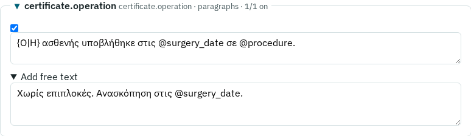

**Add free text** under a section opens a box for text written for this document only. It is printed after the
section's sentences.

- **In a list section** (`itemize`, `enumerate`, the emergency box), each line is one item.
- **In a paragraph section**, a blank line starts a new paragraph.
- **Sections with no sentences** are free-text boxes. Their grey hint (from the type) says what goes there.
- **From your earlier documents:** when the library has text written for this kind of section, its first lines are
  offered as buttons. A click adds the text to the free text, where you can change it. The patient's name and the
  values come back as `@fields`, so they take this document's values.

---

## 5. Writing text: the markup

The same short markup works in sentences, free text and table cells. Everything else is printed as typed, so no
character can break the PDF.

| You type | Printed |
| --- | --- |
| `@patient`, `@age`, `@amka`, `@clinic`, `@date` | the patient's name, age, AMKA, the clinic, the document date |
| `@surgery_date`, `@procedure`, … | the type's values (section 3) |
| `{Ο\|Η} ασθενής` | «Ο» for a man, «Η» for a woman (any pair: `{του\|της}`, `{ο\|η}`) |
| `**bold**`, `*italic*` | **bold**, *italic* |
| `{v:L4-5}` | a spine level, set the kit's way |
| a blank line | a new paragraph (a single line break is only a space) |
| `\` followed by a space | a normal space after an abbreviation (`Dr.\ X`), not a sentence-end space |
| `\*`, `\@`, `\{` | a literal `*`, `@`, `{` |
| `{br}` | a line break inside a medication-table cell |

**Insert a field into the text you are writing** (under the sections) puts the `@field` you choose at the cursor of
the last text box you clicked.

An `@name` that the type does not know is printed as written, and the checks report it (section 10).

---

## 6. Case features

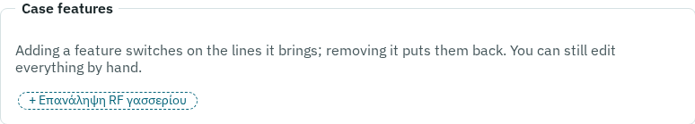

Some types offer **case features**: chips that switch on, at once, everything a common case needs. For example,
«Επανάληψη RF γασσερίου» on `proegkrisi` turns on the three RF sentences and their section. Click **+ feature** to add
it. Click the **×** on the chip to remove it, and exactly what it changed is put back.

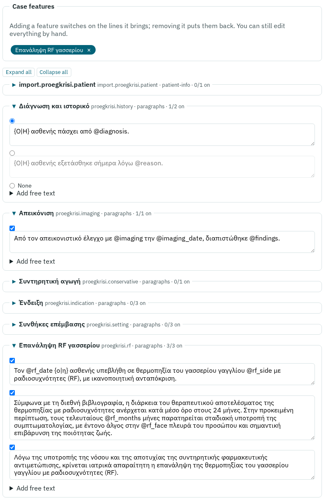

Everything a feature switched on can still be changed by hand afterwards. Adding or removing a chip saves the form
first, so nothing you typed is lost.

---

## 7. Medication tables

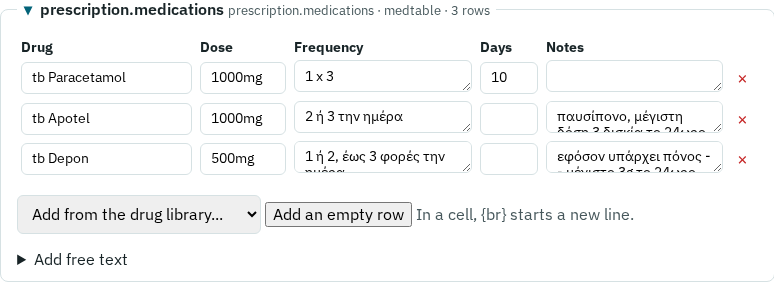

A prescription (and postoperative instructions with medication) has a table with the columns **Drug**, **Dose**,
**Frequency**, **Days** and **Notes**.

- **Add from the drug library…** adds a copy of a library entry. The entries are grouped as in the library.
- **Add an empty row** gives a blank row to fill in.
- **× removes a row.** A row with no drug name is dropped when you save.
- **Every cell can be edited.** `{br}` starts a new line inside a cell.
- **Default rows:** some types start with rows already in the table, as copies.
- **A table with no rows** is not printed.

---

## 8. Saving

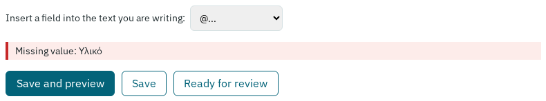

- **Save** stores the form.
- **Save and preview** stores it and builds the PDF preview (about 12 seconds; the page waits).
- **Ready for review** (secretary to doctor) sets the status to `review`. **Back to draft** sets it back. Neither
  locks anything.
- **Delete draft** (at the very bottom) deletes a document that has not been issued. Its empty DocArc record, if a code
  was reserved, is deleted too.

There is no autosave: save before you leave the page.

**While a PDF of the document is being built** (by someone else, or in another tab), a save is refused, so the text
cannot change under the build. The page comes back with "These changes are NOT saved yet" and your typing still in the
form. Press Save again a moment later.

---

## 9. The preview

The preview is the real PDF, built by the same engine and letterhead as the final copy, with two differences:

- **ΠΡΟΣΧΕΔΙΟ (draft)** is written across the page.
- **The QR codes are empty frames marked PREVIEW.** The real code only exists once DocArc gives one (section 11).

Only the latest preview of a document is kept. The preview is not refreshed by itself: press **Save and preview**
after a change.

For A5 types, **Print two A5 per A4 sheet** makes a printable copy from the latest PDF: **pages in order** puts
pages 1–2 on sheet 1, and so on; **each page twice** gives two copies of each page on one sheet, to cut in half. It is
a printing aid, not an archived file.

---

## 10. Checks

Under the sections, the **checks** say what would be wrong in print:

- **Missing value:** a required value is empty. It prints as `[label]`.
- **Unknown token @x:** a misspelled `@field`.
- **The patient's gender is needed for the Greek text:** a `{Ο|Η}` with no gender set.
- **Patient name is empty, Document date is empty, Clinic is not set.**

You can save and preview with errors (the preview shows the `[label]` placeholders), but a document with errors
cannot be issued. "All checks pass" in green means it can.

---

## 11. Issuing (doctor)

**Issue…** opens the issue page.

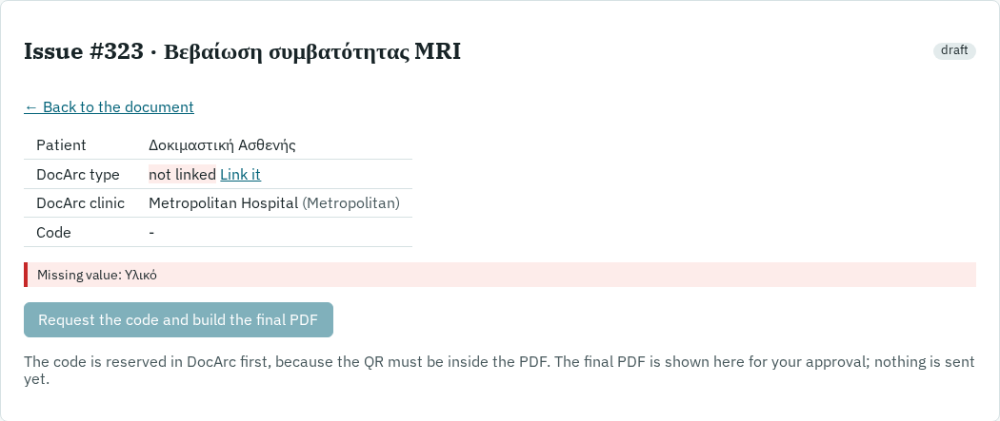

It shows:

- **the patient**;
- **the DocArc type:** each MedScribe type is linked to one DocArc document type, in **Types → DocArc links**
  (`/types/links`). "not linked" blocks issuing until it is linked;
- **the DocArc clinic:** the linked one, or none, in which case the record is sent without a clinic;
- **the code**;
- **the checks.**

The steps:

1. **Request the code and build the final PDF.**
   - DocArc creates the record first and gives its code, because the QR code inside the PDF has to point to it.
   - Then the final PDF is built with the real QR.
   - Nothing is sent yet. The status is `code_reserved` while the code is reserved and `final_compiled` once the
     final PDF is built.
2. **Look at the final PDF** on the page. It is exactly what will be archived.
   - **Approve and send to DocArc:** freezes the document and sends exactly these bytes, PDF and `.tex`; nothing is
     built again.
   - **Edit again (the code stays reserved):** back to the composer. The final PDF is built again at the next step,
     with the same code.
3. **Issued.** The page shows:
   - the **verification code** to give the patient with the QR link (the AMKA when valid, else a 6-digit code);
   - links to the PDF and the `.tex` as sent.

   If sending stopped halfway (DocArc not reachable), the status stays `approved` or `pdf_sent` and the page offers
   **Send again**. It continues where it stopped, never sends twice, and never builds again.

After issuing:

- **Copy as new (another patient):** a new draft with the same choices and text, the latest released type version,
  and no patient.
- **Withdraw:** only for a mistake that must not exist, such as the wrong patient.
  - A reason is required.
  - DocArc deletes the whole record, so the printed QR leads nowhere.
  - MedScribe keeps the document, marked withdrawn, and only the doctor can open it.
  - A correction is not a withdrawal. Revised versions of an issued document are not available yet.
- **Delete from MedScribe** (withdrawn documents only, type DELETE): removes its inputs, `.tex` and PDF. The audit log
  keeps only that it happened.

### History

**History** (on an issued or withdrawn document) lists the revisions sent to DocArc. Each has:

- its PDF and `.tex`;
- what it was built with: the letterhead files and their versions, and the TeX environment.

**Rebuild and verify** (doctor) builds the revision again from those exact files and checks that the PDF is
byte-identical to the archived one.

---

## 12. The library (doctor)

**Library** in the top bar (`/library`) lists the text from issued documents that you wrote or edited: free text and
edited sentences, not unchanged type sentences. It is grouped by section slot.

- The patient's name, AMKA, values and dates in the text are stored as `@fields`. A surname alone, or another
  grammatical form of the name, stays as written; you review every suggestion before issuing.
- **Promote** a text to make it a `library` text: within its section, it is suggested before the `history` texts.
  **Demote** reverses this.
- **Hide** a text so it is never suggested.
- Withdrawing a document removes its texts.

---

## 13. Who can do what

| | Doctor | Secretary |
| --- | --- | --- |
| Create, edit, preview, save | ✓ | ✓ |
| Ready for review / Back to draft | ✓ | ✓ |
| Delete a draft | ✓ | ✓ |
| Issue (code, final PDF, approve, send) | ✓ | |
| Withdraw, delete a withdrawn document, open a withdrawn document | ✓ | |
| Rebuild and verify | ✓ | |
| Library, types, DocArc links | ✓ | |

---

## 14. Common tasks

| To… | Do this |
| --- | --- |
| Write a document for a ZPMS patient | New document → Find in ZPMS → pick → Create draft |
| Write one for someone not in ZPMS | New document → type the name, gender, age → Create draft |
| Change a sentence for this patient only | Edit its text in the composer (it says "edited for this document") |
| Change a sentence for every future document | Change it in the type editor and release a new type version |
| Use another of the prepared sentences | Pick its round button (or tick its box) |
| Add your own sentence | Add free text under the section |
| Put a value into your text | Type `@name`, or use "Insert a field…" |
| Apply a common case | Add its case-feature chip |
| Add medication | Add from the drug library… (or an empty row) in the table |
| See the PDF | Save and preview |
| Hand a document to the doctor | Ready for review |
| Issue it | Issue… → Request the code and build the final PDF → Approve and send |
| Write the same document for another patient | Issue page → Copy as new |
| Print two A5 on one sheet | Print two A5 per A4 sheet → pages in order |
