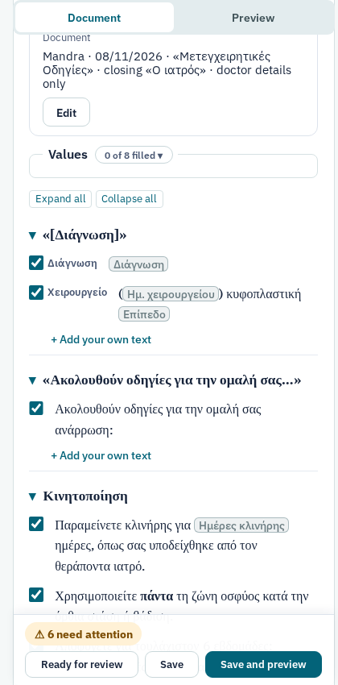
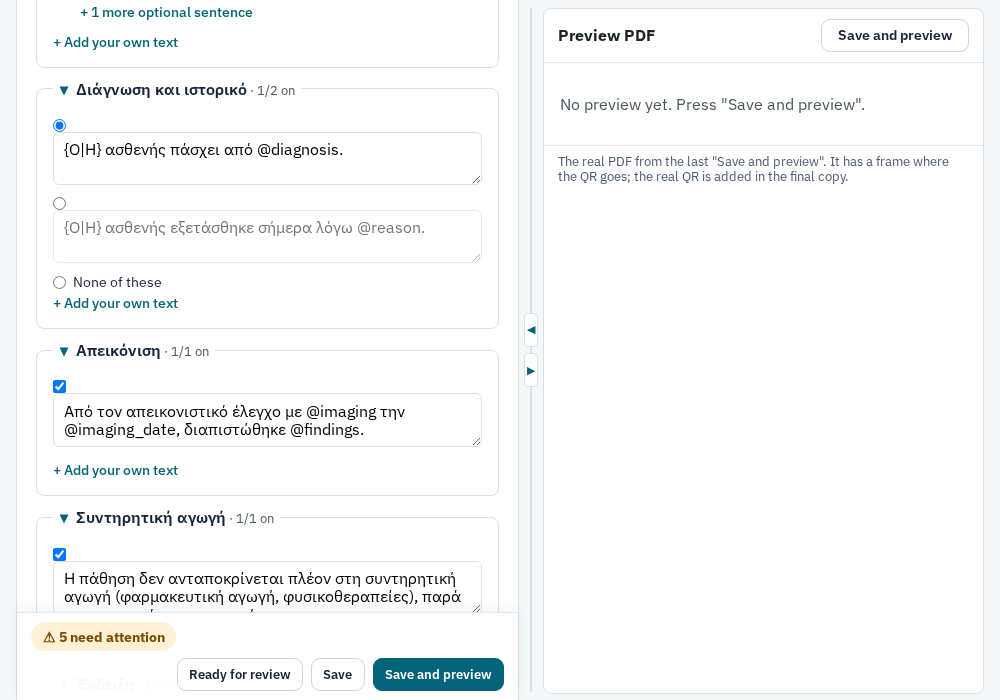
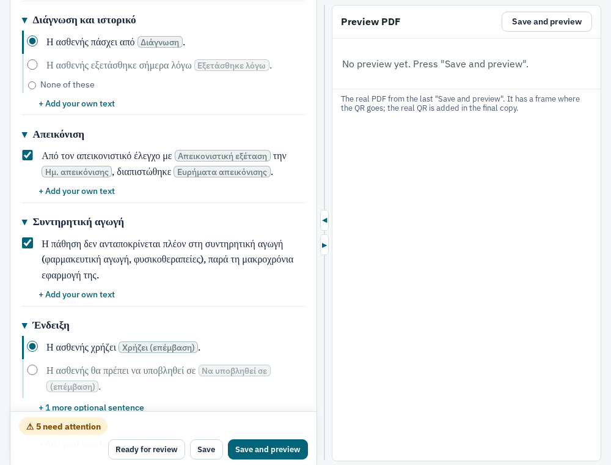
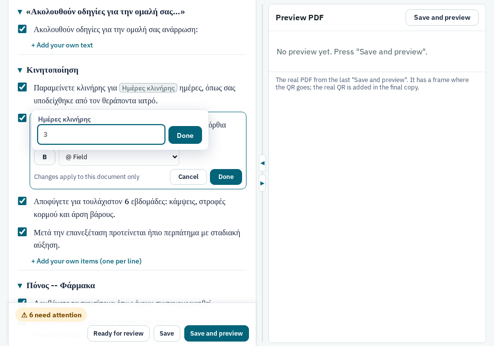
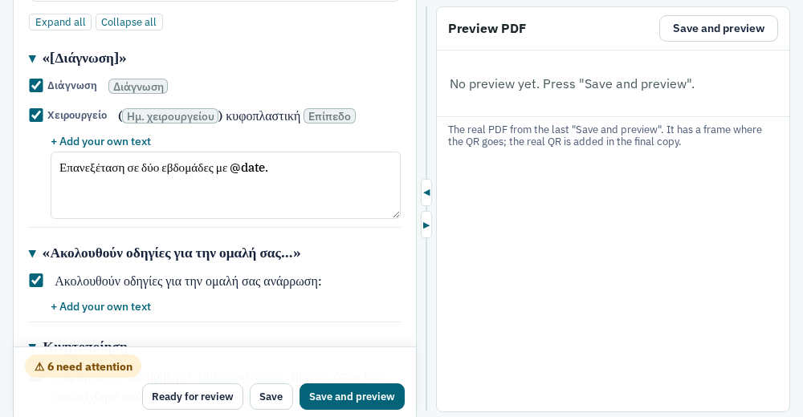
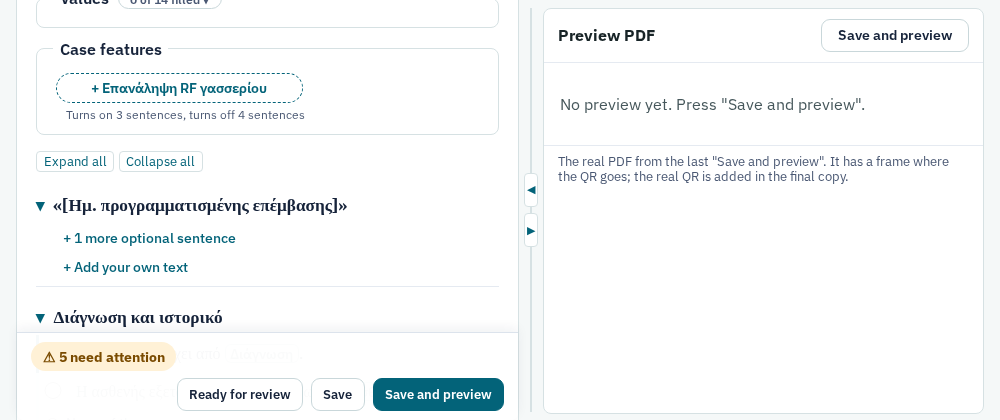
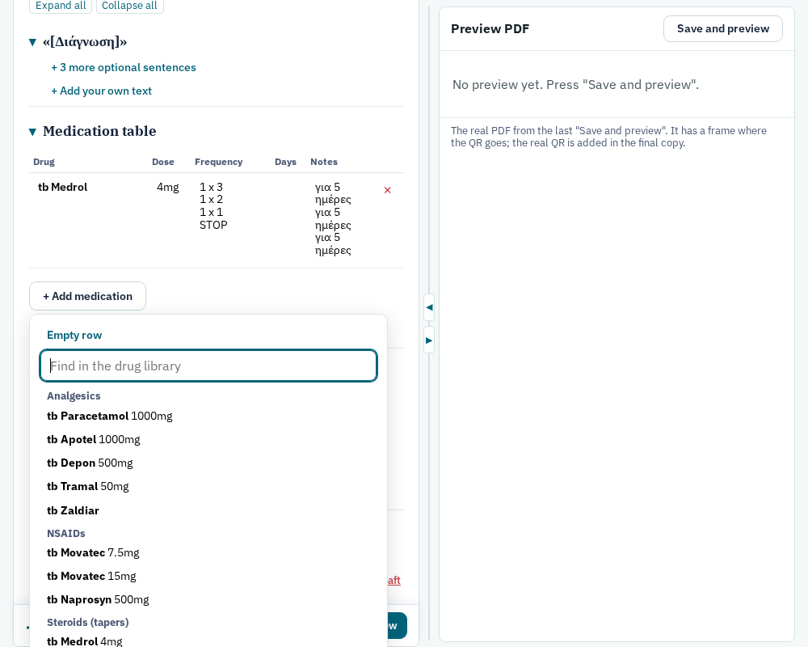
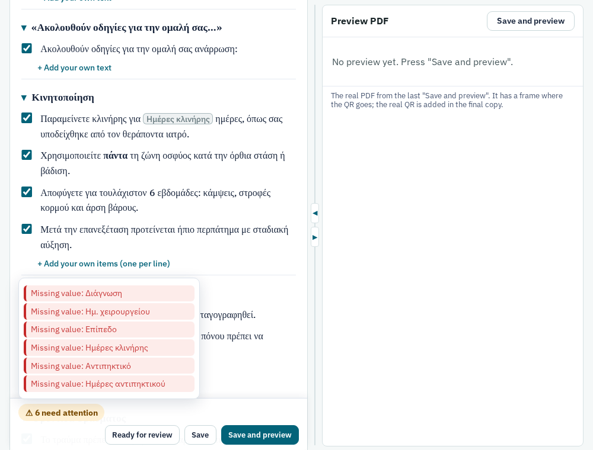

# The document composer

The composer is where a document is written: a certificate, a pre-approval, a prescription, a letter. You choose a
type and a patient. The composer then shows the document **as it will read**: you pick its prepared sentences, fill in
the values where they appear, edit a sentence for this patient, and add your own text. A PDF preview shows the real
result. When the document is ready, the doctor issues it: it gets its DocArc code and QR code, is archived in DocArc,
and can no longer change.

- **Documents** in the top bar lists every document (`/documents`).
- The **doctor** and the **secretary** both write documents. Only the doctor issues, withdraws and rebuilds them
  (section 10).
- What a document *can* say (its sections, sentences, values and case features) comes from its **type**, which is
  edited in the type editor (`docs/type-editor.md`). A document keeps the type version it was created with.

The screenshots use invented patients («Δοκιμαστική Ασθενής», …) and the types `vevaiosi-mri` (MRI compatibility
certificate), `proegkrisi` (surgery pre-approval, with a case feature), `odigies-kyfoplastiki` (postoperative
instructions) and `syntagi` (prescription).

---

## 1. The documents list

Each row shows the document (number, type and clinic), the patient, its **status**, its DocArc code once one is
reserved, when it last changed ("Today 17:30") and who created it. Click the document to open it; **+ New document**
starts one.

- **Filters:** All · Ready for review · Drafts · Issued · Withdrawn. "Ready for review" shows how many documents wait
  for the doctor. The doctor's list opens on it while it is not empty; the secretary's list opens on Drafts.
- **Search** finds a patient's name, a DocArc code, or a document number (`#123`).

The statuses, in the order a document goes through them:

| Status | Meaning |
| --- | --- |
| Draft | Being written. Anyone can edit it. |
| Ready for review | The secretary handed it to the doctor. It can still be edited. |
| Code reserved | The doctor asked DocArc for a code. The text can still be edited and the code stays. |
| Final PDF ready to approve | The final PDF (with the real QR) is built and waits for the doctor's approval. |
| Approved, sending / Sent, finishing | Approved and frozen, but not yet completely sent to DocArc (section 10 shows how to finish). |
| Issued | In DocArc. It can no longer change. |
| Withdrawn | Taken back by the doctor (a mistake such as the wrong patient). DocArc has deleted its record. |

The "Drafts" filter also shows documents half-way through issuing (code reserved, final PDF, sending).

---

## 2. A new document

1. **Document type:** every type that has a released version, by name. Type a few letters in "Find a type" to narrow
   the list (Enter picks the first match). Tags say when a type is English, A5, or has no patient.
2. **Patient** (hidden for types with no patient, marked optional where it is optional):
   - **Find in ZPMS:** type at least two letters of the name, or the AMKA, and pick the patient. The name, gender,
     AMKA and date of birth are copied in; the age is worked out at the document date.
   - **By hand:** type the details yourself. This works for every type, and when ZPMS is not reachable.
   - **Gender** matters: the Greek text agrees with it (Ο/Η ασθενής).
3. **Clinic** sets the letterhead (logo, address, phone). **Document date** is printed on the document; today is the
   default.
4. **Create draft** opens the composer.

Dates everywhere are shown as dd/mm/yyyy, with a calendar; you can also type them (`8/11/26` or `08/11/2026`).

The new document starts with the type's default choices, and with its default medication rows if it has any.

---

## 3. The composer page

- **Left:** the document. **Right:** the latest PDF preview (section 8). The splitter between them works like the
  type editor's: drag it, or use ◀ / ▶. On a narrow screen the two are **Document** and **Preview** tabs instead.
- **The header:** the document's number and type, its status, and "● Unsaved changes" once you have changed
  something. **Write · Form** switches the view (below). **Issue…** (doctor only) opens the issue page; **History**
  appears once the document is issued.
- **The action bar** stays at the bottom of the window (section 7).

On a phone or a small window, **Document** and **Preview** are tabs, and the action bar takes two rows:

### Patient

The banner shows what will be printed: the name, gender, age, AMKA, and whether the patient came from ZPMS or was typed
by hand. **Edit patient** opens the four fields in place. Changes apply to this document only: nothing is written back
to ZPMS. When a Greek type has no gender set, the banner says **Gender needed for the Greek text**.

### Document details

One line sums up the clinic, the date, the printed title, the closing and the stamp. **Edit** opens them:

- **Printed title** (e.g. «Ιατρική Βεβαίωση») and **Closing** (e.g. «Ο ιατρός»): the type's defaults. Clicking in the
  box offers the type's other titles and closings; you can also type anything. An empty closing prints no doctor block.
- **Stamp:** "Doctor details only", or "Signature and stamp".
- **Recipient** (only for types that have one).
- **Advanced → Letterhead version:** B1, B2, … are versions of the letterhead files. A document keeps the one it was
  made with. Change it only on purpose, before the code is reserved.

### Write view and Form view

- **Write** (the default) shows the document as it will read. This guide describes it.
- **Form** shows every sentence as a text box and every value as a field, as the composer used to. Both views edit
  the same document; switch at any time. The browser remembers your choice.

---

## 4. Writing in the Write view

The document is shown section by section, in print order, with each section's heading as printed. A section without a
heading is named by its first sentence in «».

### Sentences

- **The box in the margin** prints the sentence when ticked.
- **A choice group** (round buttons in one column) prints *one* of its sentences; **None of these** prints none.
- **Sentences that are off** are greyed. Optional sentences that are off are folded under **+ N more optional
  sentences**; click it to see them.
- The text is shown as printed: bold is bold, «Ο/Η» already agrees with the patient's gender (with no gender set, both
  forms are shown, highlighted), and spine levels are set as in print.
- **An optional section** has **Include this section**. When it is not ticked, the section folds to its heading and
  nothing in it is printed.
- Grey sentences that cannot be clicked are raw LaTeX from the kit: they can be switched on or off here; their text is
  changed in the type editor.
- Click a section's heading to fold or open it; **Expand all** / **Collapse all** act on every section. Folding only
  changes the screen.

### Values

A value appears **where it is used**, as a coloured chip. An empty value shows its name in grey (in amber when it is
required). **Click a chip** to fill it in: a small box opens (with a calendar for dates), and the sentence is updated
at once, together with every other place that uses the same value.

**Values · N of M filled** (above the sections) opens the list of every value of the type, including those used only
in sentences that are off.

### Editing a sentence for this patient

Click a sentence to edit it. It opens as text with its values as chips (hover a chip to see its `@field`).

- **B** (or Ctrl+B) makes the selection bold; **@ Field** inserts a value at the cursor.
- **Done** (or Ctrl+Enter) keeps the change; **Cancel** (or Esc) leaves the sentence as it was.
- The change is for this document only: the sentence says **edited for this document · Restore original**. **Restore
  original** brings back the type's wording. The type itself is never touched.
- A sentence whose text cannot be shown safely with chips opens as plain text instead; it is edited the same way.

### Your own text

**+ Add your own text** under a section opens a box for text written for this document only. It is printed after the
section's sentences.

- **In a list section** (bullets, numbered lists, the emergency box) it says **+ Add your own items (one per line)**:
  each line is one item.
- **In a paragraph section**, a blank line starts a new paragraph.
- **Sections with no sentences** are just this box. Their grey hint (from the type) says what goes there.
- **Suggestions (N)** appears when the library has text written for this kind of section. It opens a panel with the
  texts; **Use** copies one into the box, where you can change it. The patient's name and the values come back as
  `@fields`, so they take this document's values.

---

## 5. Case features

Some types offer **case features**: chips that switch on, at once, everything a common case needs. Each chip says what
it changes, for example «Επανάληψη RF γασσερίου» on `proegkrisi`: "Turns on 3 sentences, turns off 4 sentences". Click
**+ feature** to add it. Click the **×** on the chip to remove it, and exactly what it changed is put back.

Everything a feature switched on can still be changed by hand afterwards. Adding or removing a chip saves the document
first, so nothing you typed is lost.

---

## 6. Medication tables

A prescription (and postoperative instructions with medication) has a table with the columns **Drug**, **Dose**,
**Frequency**, **Days** and **Notes**.

- **+ Add medication** offers **Empty row**, or the **drug library**: type to find a drug, grouped as in the library.
  The entry is copied into the table.
- **Every cell can be edited.** Enter starts a new line inside a cell (a tapering dose shows one step per line).
- **×** removes a row. A row with no drug name is dropped when you save.
- Some types start with rows already in the table, as copies. A table with no rows is not printed.

---

## 7. Saving, and the checks

The bar at the bottom of the document:

- **Checks:** "✓ All checks pass", or "⚠ N need attention". Click it for the list; **click a check to go to its
  place**: the value's chip opens, or the sentence, the section, or the patient's details are shown. The checks follow
  your changes before you save.
  - **Missing value:** a required value is empty. It prints as `[name]`.
  - **Unknown token @x:** a misspelled `@field` in your text.
  - **The patient's gender is needed for the Greek text.**
  - **Patient name is empty, Document date is empty, Clinic is not set.**

  You can save and preview with checks failing, but such a document cannot be issued.
- **Saved / Unsaved changes / Saving…:** whether the document on the server has your latest changes. Leaving the page
  with unsaved changes asks first. There is no autosave.
- **Ready for review** (secretary to doctor) sets the status to Ready for review; **Back to draft** sets it back.
  Neither locks anything.
- **Save** stores the document. **Save and preview** stores it and builds the PDF preview (about 12 seconds).
- **Delete this draft** (just above the bar) deletes a document that has not been issued. Its empty DocArc record, if
  a code was reserved, is deleted too.

**While a PDF of the document is being built** (by someone else, or in another tab), a save is refused, so the text
cannot change under the build. The page comes back with "These changes are NOT saved yet" and your typing still in the
form. Press Save again a moment later.

---

## 8. The preview

The preview is the real PDF, built by the same engine and letterhead as the final copy, with two differences:

- **ΠΡΟΣΧΕΔΙΟ (draft)** is written across the page.
- **The QR codes are empty frames.** The real code only exists once DocArc gives one (section 10).

The header says when the preview was built. It is not refreshed by itself: after a change it says **Out of date**
until you press **Save and preview** (in the bar, or above the preview).

For A5 types, **Print** offers two A5 pages per A4 sheet, made from the latest PDF: **pages in order** puts pages 1–2
on sheet 1, and so on; **each page twice** gives two copies of each page on one sheet, to cut in half. It is a printing
aid, not an archived file.

---

## 9. Writing text: the markup

The same short markup works in edited sentences, your own text and table cells. Everything else is printed as typed,
so no character can break the PDF.

| You type | Printed |
| --- | --- |
| `@patient`, `@age`, `@amka`, `@clinic`, `@date` | the patient's name, age, AMKA, the clinic, the document date |
| `@surgery_date`, `@procedure`, … | the type's values |
| `{Ο\|Η} ασθενής` | «Ο» for a man, «Η» for a woman (any pair: `{του\|της}`, `{ο\|η}`) |
| `**bold**`, `*italic*` | **bold**, *italic* |
| `{v:L4-5}` | a spine level, set the kit's way |
| a blank line | a new paragraph (a single line break is only a space) |
| `\` followed by a space | a normal space after an abbreviation (`Dr.\ X`), not a sentence-end space |
| `\*`, `\@`, `\{` | a literal `*`, `@`, `{` |

In the sentence editor, values are chips and you rarely need to type `@`. An `@name` that the type does not know is
printed as written, and the checks report it.

---

## 10. Issuing (doctor)

**Issue…** opens the issue page. It shows three steps, a summary (the patient, the DocArc type the document is linked
to, the clinic, the code, the checks), and the step you are at.

1. **Prepare: Reserve the code and build the final PDF.**
   - DocArc creates the record first and gives its code, because the QR code inside the PDF has to point to it.
   - Then the final PDF is built with the real QR. Nothing is sent yet.
   - When this cannot run yet, the page says why under **Not yet:** (DocArc is not configured; the type is not linked
     to a DocArc type: link it in **Types → DocArc links**; checks fail: fix them in the document).
2. **Review the final PDF.** It is exactly what will be archived.
   - **Approve and send to DocArc:** freezes the document and sends exactly these bytes, PDF and `.tex`; nothing is
     built again.
   - **Edit again (the code stays reserved):** back to the composer. The final PDF is built again at the next step,
     with the same code.
   - If sending stopped half-way (DocArc not reachable), the page says **Sending stopped** and offers **Send again**.
     It continues where it stopped, never sends twice, and never builds again.
3. **Issued.** The page shows the code, the **verification code** to give the patient with the QR link (the AMKA when
   valid, else a 6-digit code), and the PDF and `.tex` as sent.

After issuing:

- **Copy as new (another patient):** a new draft with the same choices and text, the latest released type version,
  and no patient.
- **Withdraw** (red section): only for a mistake that must not exist, such as the wrong patient.
  - A reason is required.
  - DocArc deletes the whole record, so the printed QR leads nowhere.
  - MedScribe keeps the document, marked Withdrawn, and only the doctor can open it.
  - A correction is not a withdrawal. Revised versions of an issued document are not available yet.
- **Delete from MedScribe** (withdrawn documents only, type DELETE): removes its inputs, `.tex` and PDF. The audit log
  keeps only that it happened.

### History

**History** (on an issued or withdrawn document) shows one card per revision sent to DocArc, with its PDF and `.tex`,
and what it was built with (the letterhead files and their versions, the TeX environment). **Rebuild and verify**
(doctor) builds the revision again from those exact files and checks that the PDF is byte-identical to the archived
one.

---

## 11. The library (doctor)

**Library** in the top bar (`/library`) shows, as cards, the text from issued documents that you wrote or edited: your
own text and edited sentences, not unchanged type sentences. Filter by section slot with the chips at the top.

- The patient's name, AMKA, values and dates in the text are stored as `@fields`. A surname alone, or another
  grammatical form of the name, stays as written; you review every suggestion before issuing.
- **Promote** a text to make it a Library text: within its section it is suggested before the History texts.
  **Demote** reverses this.
- **Hide** a text so it is never suggested.
- Withdrawing a document removes its texts.

---

## 12. Who can do what

| | Doctor | Secretary |
| --- | --- | --- |
| Create, edit, preview, save | ✓ | ✓ |
| Ready for review / Back to draft | ✓ | ✓ |
| Delete a draft | ✓ | ✓ |
| Issue (code, final PDF, approve, send) | ✓ | |
| Withdraw, delete a withdrawn document, open a withdrawn document | ✓ | |
| Rebuild and verify | ✓ | |
| Library, types, DocArc links | ✓ | |

---

## 13. Common tasks

| To… | Do this |
| --- | --- |
| Write a document for a ZPMS patient | New document → Find in ZPMS → pick → Create draft |
| Write one for someone not in ZPMS | New document → type the name, gender, age → Create draft |
| Fill in a value | Click its chip in the text (or open "Values") |
| Change a sentence for this patient only | Click it, edit, Done (it says "edited for this document") |
| Undo that change | Restore original |
| Change a sentence for every future document | Change it in the type editor and release a new type version |
| Use another of the prepared sentences | Pick its round button (or tick its box); "+ N more" shows the hidden ones |
| Add your own sentence | + Add your own text under the section |
| Apply a common case | Add its case-feature chip |
| Add medication | + Add medication → find it in the library (or Empty row) |
| Find what still needs fixing | Click "N need attention", then a check |
| See the PDF | Save and preview |
| Hand a document to the doctor | Ready for review |
| Issue it | Issue… → Reserve the code and build the final PDF → Approve and send |
| Write the same document for another patient | Issue page → Copy as new |
| Print two A5 on one sheet | Print (above the preview) → pages in order |
| Work on a phone or a small screen | Use the Document / Preview tabs |
