# The type editor

The type editor is where a document type is defined: its fields, its sections and their prepared sentences, its case
rules. It is open to the **doctor** only:

- a type: **Types → a type** (`/types/typedef/<name>`);
- a shared component, such as the "purpose" sentences or the drug library: `/types/shared/<name>`.

What you edit is the type's definition. The editor shows it in tabs: **Structure** (the parts of the document),
**Content** (its sentences), **Fields** (the values the composer asks for), **Case rules** (the composer's chips) and
**JSON** (the definition as text, for anything unusual). A live **preview** stands beside the tabs.

Nothing you do here touches existing documents: each document keeps the type version it was created with. A new version
is used by new documents only once it is **released**, from its **Review & release** page.

The screenshots show `odigies-kyfoplastiki` (postoperative instructions after kyphoplasty), `proegkrisi` (surgery
pre-approval) and the shared components `purpose` and `drug-library`, with sample values. The first editor is still
reachable at `?ui=classic` (link at the bottom of the page).

---

## 1. The page

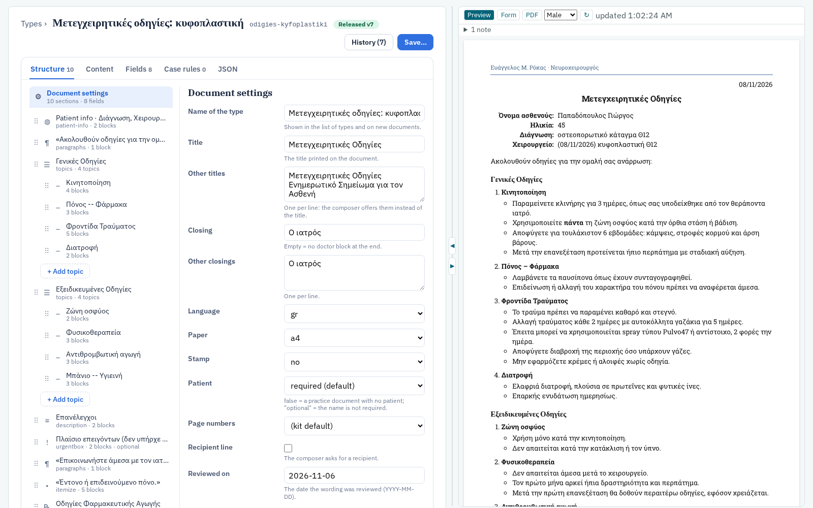

- **Header:** the type's name, its code name, and the version you are editing: **Draft vN** (amber) or **Released vN**
  (green). When another version is the one new documents use, it says so. **● Unsaved changes** appears as soon as
  the text differs from the saved version, and the browser warns before you leave the page.
- **History (N):** opens the list of versions in the page: who saved each one and when, its note, how many documents
  use it, a link to the line-by-line difference with the version before, and **Review & release** for drafts. Click a
  version number to edit with that version as the starting point.
- **Save…** opens the save dialog (section 9). **Review & release** (drafts only) opens the review page (section 10).
- **Tabs:** the number beside a tab counts what it holds (sections, fields, case rules). The browser remembers the last
  tab per type. With the keyboard: ← → move between tabs.
- **Preview** on the right (section 8). Between the two is the **splitter**: drag it, or use ◀ / ▶ to widen or narrow
  the preview (editor only → both → preview only); double-click it for the default widths.

All tabs edit the same definition: a change in one is in the others at once, and in the preview about a second later.

---

## 2. Structure

The list on the left is the document from top to bottom.

- **Document settings** (first item): the type's name, the title and other titles the composer offers, the closing and
  other closings (empty closing = no doctor block), language, paper, stamp, whether there is a patient (required,
  `false` for practice documents, `optional`), page numbers, a recipient line, and the date the wording was reviewed.
- **Sections**, each with an icon for its layout and a short description (`topics · 4 topics`, `paragraphs · 1 block`,
  `optional`, …). A `topics` section lists its topics under it.
- Each row has, when the mouse is over it: **⌖** (show it in the preview), **↑ ↓** (move), **⧉** (duplicate, with new
  ids), **✕** (delete). Rows can also be dragged by **⠿**, or moved with **Alt+↑ / Alt+↓** when focused.
- **+ Add topic** under a topics section; **+ Add section** at the bottom, with its layout chosen beside the button.

### How sections are named

Many sections have no heading. The editor names them everywhere by: the **name on the input form** (`label`), else the
**heading**, else what they hold: `Patient info · <row labels>`, `Shared: <component>`, the medication table's title, or
the start of the first sentence in «…». The composer's form uses the same name, so the editor and the form never
disagree.

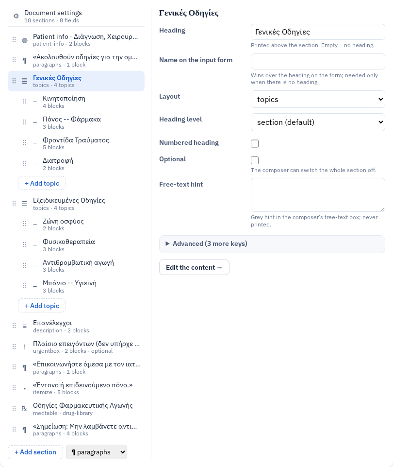

A selected section shows its properties: **Heading** (printed; empty = none), **Name on the input form** (wins over the
heading on the form; needed only when there is no heading), **Layout**, **Heading level** and **Numbered heading** (when
there is a heading), **Optional** (the composer can switch the section off) and **On by default**, and the
**Free-text hint** (grey text in the composer's free-text box, never printed). A medication table has its own fields
(section 7). A topic has its **Title** and **Style** (bullets, or running text).

Changing between `topics` and another layout, or to or from a medication table, is refused: those sections hold their
contents differently; make a new section and move the sentences.

**Advanced** (folded) lists every other key of the item, so nothing is out of reach: plain values can be edited there,
lists and objects are named with a pointer to the JSON tab. It also holds the **id** with **Rename…**; renaming an id
updates the case rules that point to it. **Edit the content →** opens the section in the Content tab.

---

## 3. Content

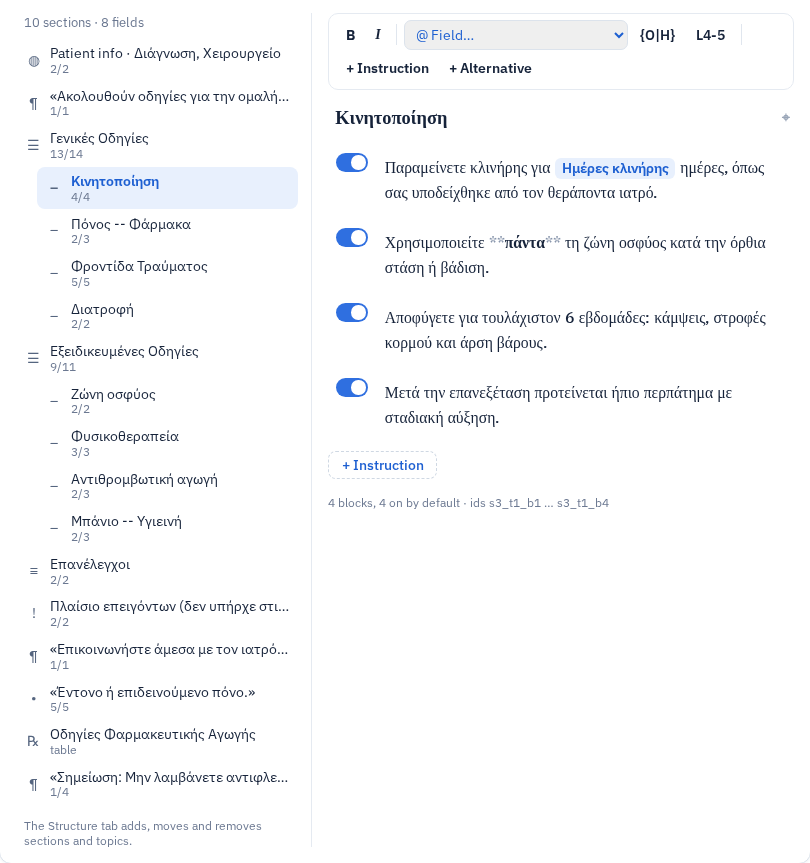

On the left, the outline: sections and their topics, each with how many of its sentences are on by default
(`13/14`). On the right, the selected section or topic as a document: its heading (edit it in place), then one row per
**sentence** (a "block": one sentence or bullet that is switched on or off as a unit).

Each row has:

- the **switch**: on by default or not;
- the **text**. Fields are shown as **chips** with their label (`Ημέρες κλινήρης`). Markup is shown in colour: the
  text between `**` is bold and between `*` italic (the stars stay visible, in grey), `{Ο|Η}` (gender variants) in
  purple, `{v:L4-5}` (spine level) in teal, `{br}` and `\ ` in grey;
- a label box before the text in rows that print one (patient-info rows, description terms, emergency-box headings);
- notes under the text when the sentence has a date format, continues the paragraph before it, or is a bullet under
  a paragraph.

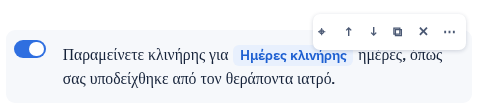

**Hovering (or focusing) a chip shows what is stored**: `@bedrest_days`. That `@token` is what the definition holds; the
chip is only how it is shown. A sentence that uses a name the type has no field for keeps it as plain text, with a red
note under the row.

### The toolbar

| Button | Inserts, at the caret |
|---|---|
| **B** / **I** (Ctrl+B / Ctrl+I) | `**…**` / `*…*` around the selected text |
| **@ Field…** | a field of the type, or a built-in value (patient name, age, AMKA, clinic, document date), as a chip |
| **{Ο\|Η}** | a gender variant; the selected text becomes the male form: `{selected\|}` |
| **L4-5** | a spine level `{v:…}` (it asks for the level) |
| **+ Instruction** | a new sentence after the one with the caret |
| **+ Alternative** | an alternative to the sentence with the caret: the two become a choice group |

Enter makes a line break inside the sentence; pasted text is pasted as plain text. (The browser's own undo, Ctrl+Z,
does not reach back across the re-colouring that follows each keystroke; **Reset the text** in the save dialog goes back
to the saved version.)

### A sentence's tools

Over a row: **⌖ ↑ ↓ ⧉ ✕** as in Structure, and **⋯** for more:

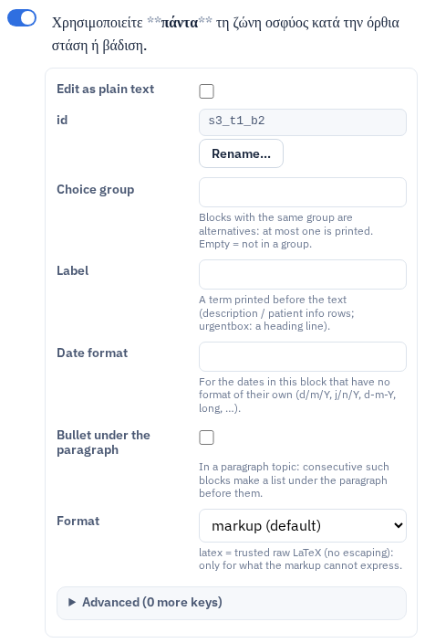

- **Edit as plain text**: the text box shows the raw text, `@tokens` and all;
- **id** with **Rename…** (the case rules that point to it follow);
- **Choice group** (sentences with the same group are alternatives: at most one is printed);
- **Label**, **Date format** (for the dates in this sentence that have no format of their own), **Continue the
  paragraph**, **Bullet under the paragraph**, **Format** (`latex` = trusted raw LaTeX, only for what the markup
  cannot express).

Sentences in raw LaTeX are shown read-only, with a badge; their text is edited under ⋯.

### Alternatives

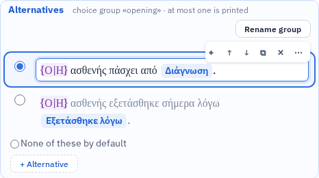

Sentences of one choice group are drawn together in an **Alternatives** box. The radio button chooses the one that is
printed by default; **None of these by default** leaves the choice to the composer. **Rename group** renames the group
in all its sentences; **+ Alternative** adds another sentence to it.

### Safe by construction

The chip editor never changes text it does not understand. Before a sentence is shown with chips, the editor builds it
and reads it straight back; a sentence that does not come back byte for byte opens as plain text, with a grey note. The
same check runs after every edit, before anything is written. The colours are only shown: what is saved is the text as
typed.

---

## 4. Fields

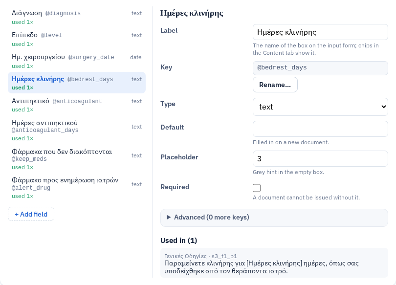

The list shows each field's label, its `@key`, its type, whether it is required, and how many times it is used.
**unused** (amber) means no sentence prints it. **↑ ↓** set the order of the boxes on the composer's form;
**+ Add field** asks for a key (a-z, 0-9 and `_`, starting with a letter, not a built-in value).

A selected field shows its **Label**, its **Key** with **Rename…**, **Type** (text, date, number), for dates the
**Date format** (it wins everywhere the field is printed: `d/m/Y` → 20/02/2026, `j/n/Y` → 20/2/2026, `long` → 20
Φεβρουαρίου 2026, or any PHP date pattern), **Default**, **Placeholder** and **Required**. **Used in** lists every
sentence that prints it; click one to open it in the Content tab.

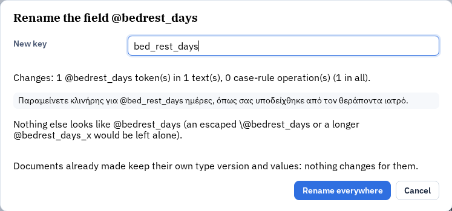

**Rename…** shows, before anything happens, how many `@tokens` and case-rule operations change, the sentences
themselves, and what is deliberately left alone (an escaped `\@key`, a longer `@key_x`). **Rename everywhere** does it.

---

## 5. Case rules

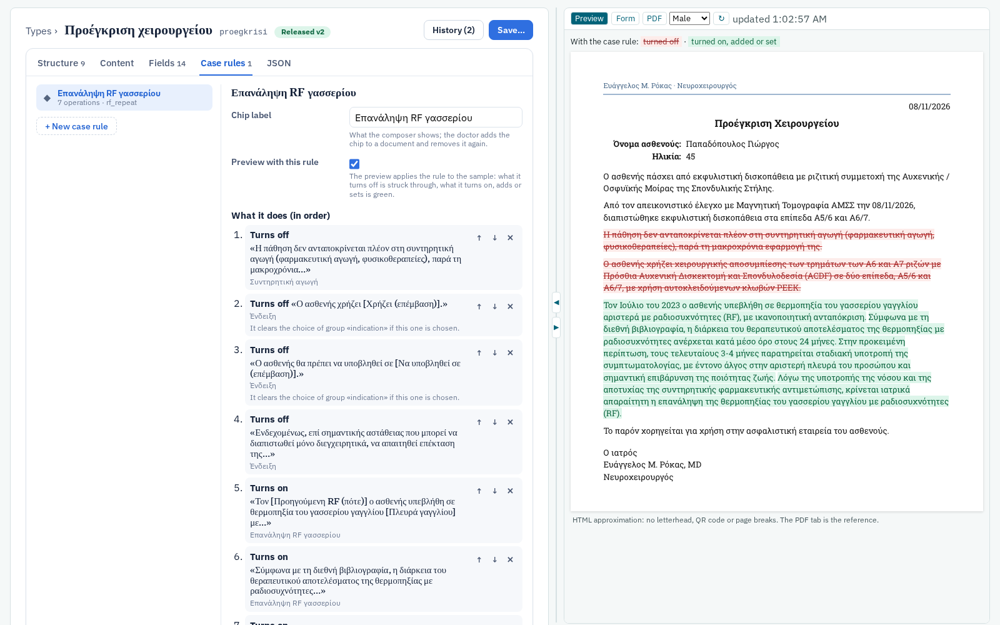

A case rule is a chip in the composer (for example «Επανάληψη RF γασσερίου») that switches sentences on or off, sets
fields or adds text in one click, and undoes exactly that when it is removed. A rule only sets what the doctor could set
by hand; any text it adds is the doctor's own wording.

The tab lists the rules; a selected rule shows its **chip label** and **what it does, in order**, as sentences:
**Turns off** «…» (section › topic), **Turns on** «…», **Sets the field** … **to** …, **Adds text to** …. For a sentence
in a choice group it says what happens to the group. An operation whose sentence, section or field no longer exists is
shown in red. Add operations with **+ Turn on a sentence**, **+ Turn off a sentence** (a searchable list of all
sentences), **+ Set a field**, **+ Add text**.

**Preview with this rule** applies the rule to the sample: what it turns off stays visible, struck through in red; what
it turns on, adds or sets is green. Leaving the tab turns this off.

---

## 6. Shared components

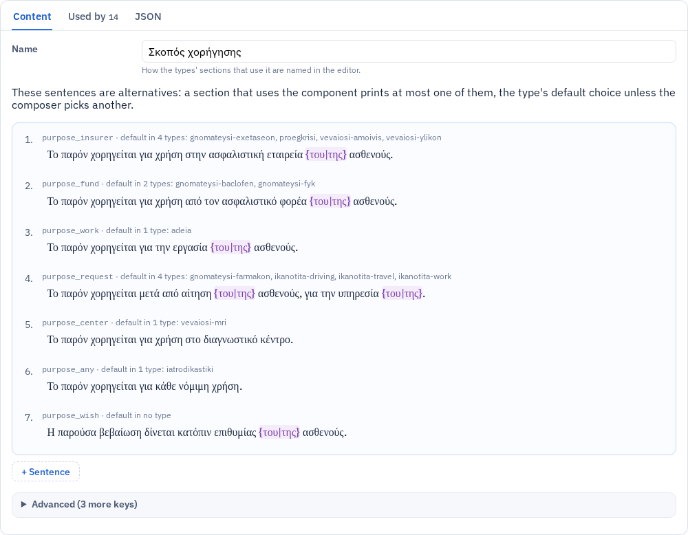

A shared component is stored once and used by many types; each type **pins** the version it was released with.

- **Content**: for sentences (such as "purpose"), the alternatives with, for each, the types that use it as their
  default choice. Those cannot be renamed or deleted here while types use them.
- **Used by**: every type that pins the component, the version it pins, its default choice, and **Update pin** when a
  newer release exists. A type that pins the component without using it is flagged.

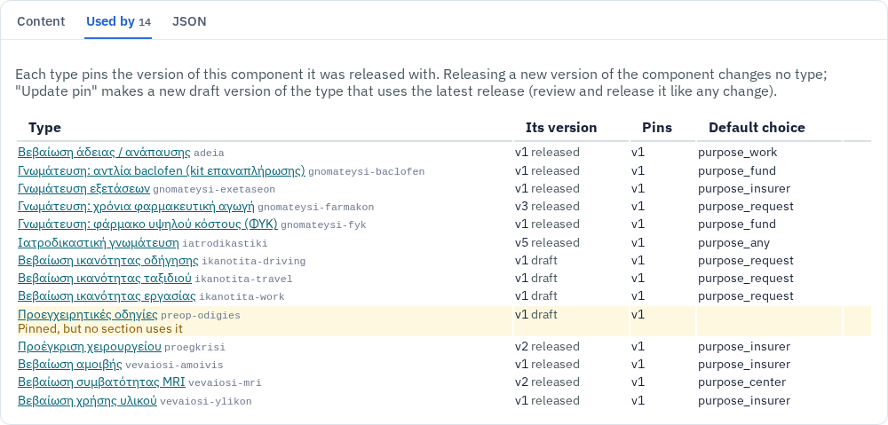

Releasing a new version of a component changes no type. **Update pin** makes a new **draft** version of that type
pinned to the latest release ("Update purpose to vN"), to review and release like any change.

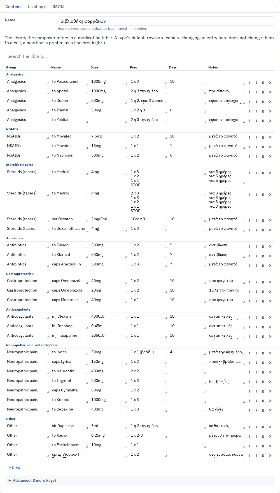

The drug library is a grouped, searchable table. In a cell a new line stands for a line break in the printed table.

---

## 7. Medication tables

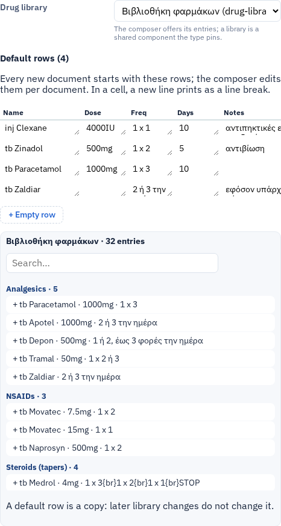

A medication-table section (Structure or Content tab) has its **title**, the **text above the table**, its **drug
library**, and its **default rows**: the rows every new document starts with, edited per document in the composer.
Copy an entry of the library with **+** (the library is searchable), or add an empty row. A default row is a copy:
later changes to the library do not change it.

---

## 8. The preview

The panel beside the editor shows the definition as you edit it, with a sample patient (choose **Male** or **Female**
to check every `{Ο|Η}`) and sample values (each field's default, else its placeholder, else its label; dates get a real
date so their format shows).

- **Preview**: what the printed document contains, in HTML, from the same engine that writes the PDF. No letterhead,
  QR code or page breaks: the PDF tab is the reference.
- **Form**: the composer's input form for this type, greyed out.
- **PDF**: **Build the test PDF** compiles the unsaved definition exactly as a composer preview (draft mark, the QR
  code drawn as an empty frame) in about 12 seconds. After an edit it says the PDF is out of date; build it again.
  It is the same PDF the composer makes for the same values (checked by the test suite).

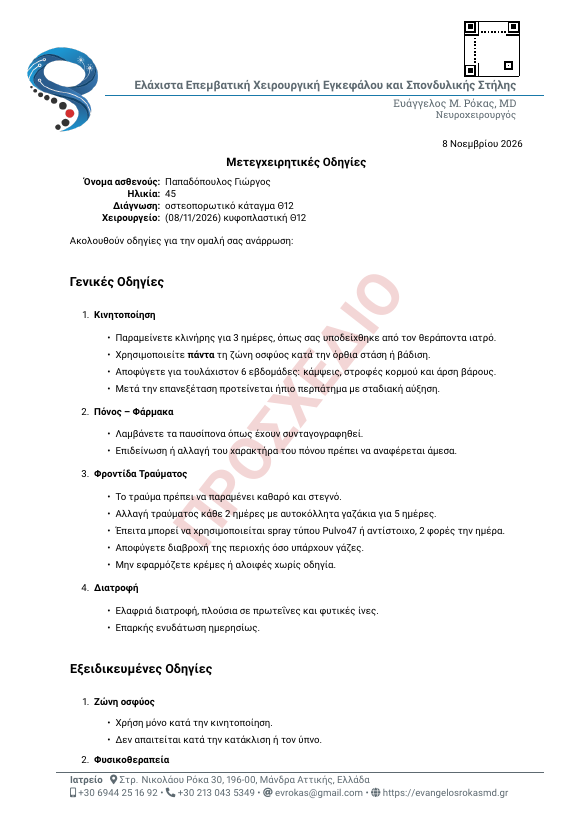

### Problems and Go to source

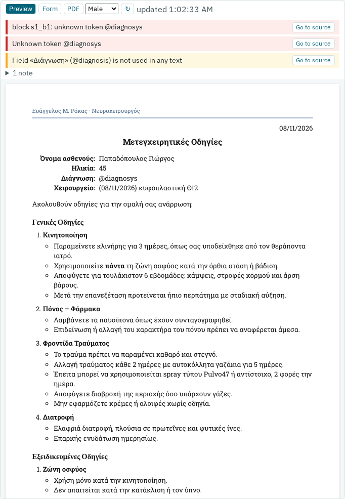

Problems are listed above the preview while you edit: errors in red (they would stop a save), warnings in amber, and
notes folded under "N notes". Where a problem knows its place, **Go to source** opens it in the editor. Warnings that
never block a save point out: a field no sentence prints, a shared component pinned but not used, a case-rule operation
whose target is gone, a date format on a sentence with no date.

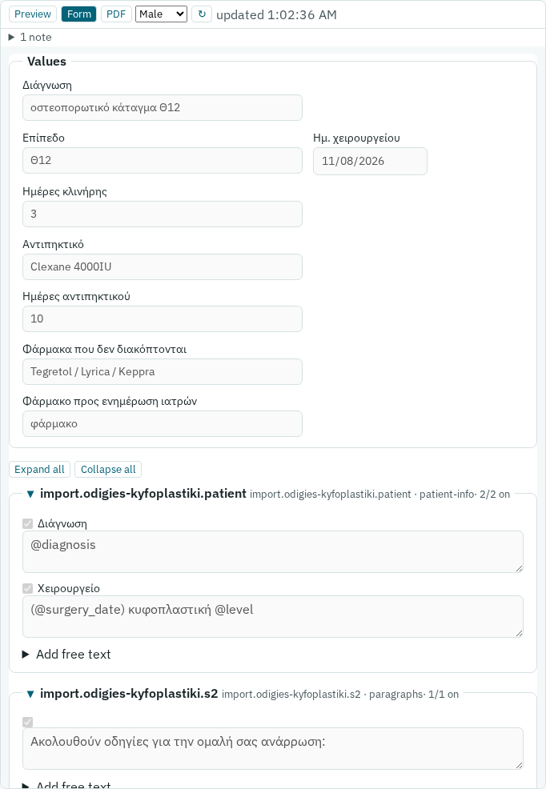

### ⌖: from the preview to the editor and back

Move the mouse over printed text in the preview: a **⌖** appears beside it. Clicking it opens the source in the current
tab's terms: a field in Fields, a sentence or heading in Content, the title or closing in Document settings (in the
JSON tab: the text is selected). The **⌖** of a row in the editor highlights its text in the preview, or says that
nothing is printed for it with the sample values.

---

## 9. JSON and saving

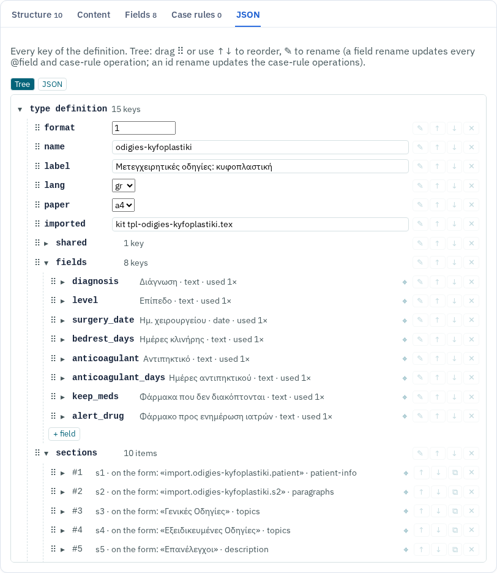

The **JSON** tab is the definition itself, as a tree (every key a row, drag to reorder, ✎ to rename with everything
that depends on the name) or as text. Leaving the tab with a syntax error is refused, with the line of the error.

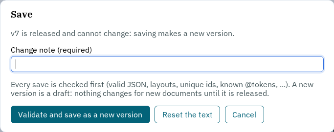

**Save…** asks for a **change note** and offers:

- **Validate and save in vN**: only while the version is the latest, still a draft, and no document uses it; the note
  is optional and replaces the old one when given;
- **Validate and save as a new version**: always; the note is required; the new version is a **draft**;
- **Reset the text**: throw away the unsaved edits.

Every save is checked first (valid JSON, layouts, unique ids, known `@tokens`, date formats only on date fields, …). A
refused save keeps your text on the page, says why, and marks it **not saved**. A released version never changes.

---

## 10. Review & release

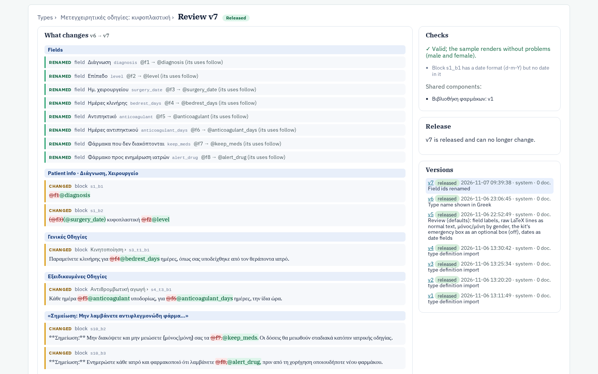

**Review & release** (a draft's header, or its row in History) compares the version with the one new documents use now
and lists **what changes**, grouped by section: sentences added, removed, changed (the changed words highlighted:
removed in red, added in green), moved; fields added, removed, renamed (one item, "its uses follow") or changed; case
rules; settings; shared components. **Raw JSON diff** shows the line-by-line difference.

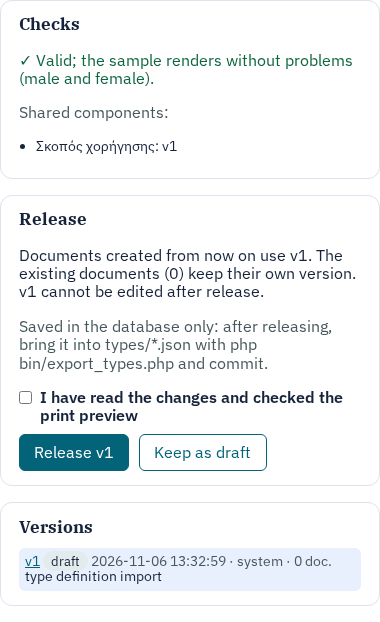

Beside it: the **checks** (the server's validation and the sample, male and female), the notes, the shared components
it pins, and the **release**: what it means ("Documents created from now on use vN; the existing documents keep their
own version; vN cannot be edited after release"), the box **I have read the changes and checked the print preview**,
then **Release vN**, or **Keep as draft**. A version with errors cannot be released.

### The repo files

The editor saves into MedScribe's database, not into the repo's `types/*.json`. After releasing, bring the change into
the files and commit it:

```
php bin/export_types.php --check     # what differs
php bin/export_types.php             # write types/*.json
git diff types/                      # review, then commit
```

---

## 11. Common tasks

| Task | How |
|---|---|
| Change a sentence | ⌖ on it in the preview, or find it in Content; type. |
| Insert a field into a sentence | Click into the sentence → **@ Field…**. |
| See which field a chip is | Hover it: it shows the `@token`. |
| Make a sentence start switched on or off | Its switch in Content. |
| Offer alternative sentences (one printed at a time) | Click into one → **+ Alternative**; choose the default with the radio buttons. |
| Give a section a readable name on the form | Structure → the section → **Name on the input form**. |
| Reorder sections or topics | Structure: drag ⠿, or ↑ / ↓. |
| Rename a field | Fields → the field → **Rename…** (every `@field` follows). |
| Change how a date prints | Fields → the date field → **Date format**. |
| Make or change a composer chip | Case rules; check it with **Preview with this rule**. |
| Check the female wording | Preview → **Female**. |
| See the real PDF | Preview → **PDF** → **Build the test PDF**. |
| See what the secretary fills in | Preview → **Form**. |
| Change the default rows of a prescription | Content → the medication table → default rows, or **+** from the library. |
| Use a newer version of a shared component | The component → **Used by** → **Update pin**, then review and release the type. |
| Put a change into use | **Save…** → save as a new version → **Review & release**. |
| Keep the change in git | `php bin/export_types.php`, review, commit. |

The full format of a type (every key a section, sentence or field can have) is in the header comment of `web/render.php`;
the design of this editor is in `docs/plans/type-editor-ui.md`.
