# The type editor

The type editor is where a document type is defined: its fields, its sections and their prepared texts, its case
features. It is open to the **doctor** only, at **Types → a type** (`/types/typedef/<name>`; shared components such as
the "purpose" sentences and the drug library are at `/types/shared/<name>`).

What you edit is the type's JSON definition. The editor gives you three ways to work with it, side by side:

- a **tree**, where every part of the definition is a row you can edit, rename, move, copy or delete;
- the raw **JSON** text, for anything unusual;
- a live **preview** of the result, either as the **input form** a document of this type gets or as the **printed
  document**.

Nothing you do here touches existing documents: each document keeps the type version it was created with. A new
version is used by new documents only once it is **released**.

> **Note (2026-11-07):** this guide describes the first editor, now at `?ui=classic`. The editor is being redesigned
> (`docs/plans/type-editor-ui.md`): Structure, Content and Fields tabs, and a **Review & release** page that replaced the
> one-click Release of the versions table (releasing now needs a confirmation there). The guide will be rewritten when
> the redesign is finished.

The screenshots show `odigies-kyfoplastiki` (postoperative instructions after kyphoplasty) with sample values.

---

## 1. The page

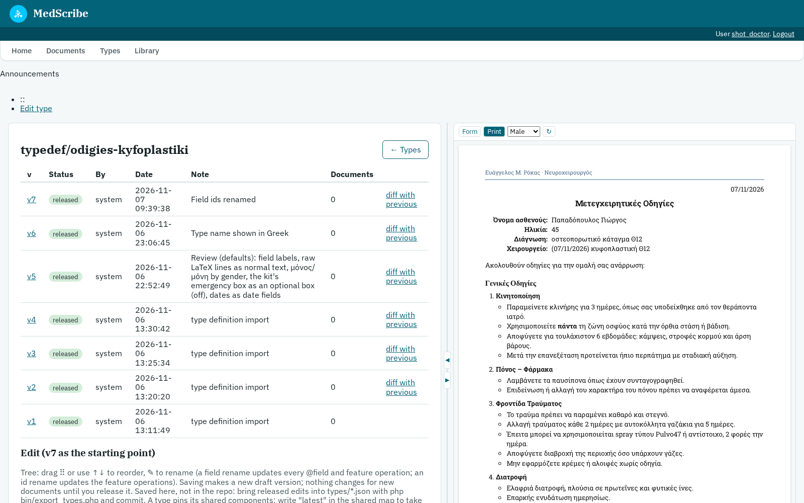

The page has two panes:

- **Left:** the type's name, its **versions** and, below them, the **editor**.
- **Right:** the **preview panel**. It stays in view while the left pane scrolls.

### Versions

Each row is one version of the type, newest first:

| Column | Meaning |
|---|---|
| **v** | The version number. Click it to load that version into the editor as the starting point. |
| **Status** | `released` (used by new documents; never changes again) or `draft` (not used by any document yet). |
| **By / Date** | Who saved it and when (`system` = imported from the repo files). |
| **Note** | The change note given when it was saved. |
| **Documents** | How many documents were created from this version. |
| **diff with previous** | The line-by-line changes against the version before it. |
| **Review & release** | (drafts only) Opens the review page: what changes, the checks, and the release (with a confirmation). |

---

## 2. The editor and the preview

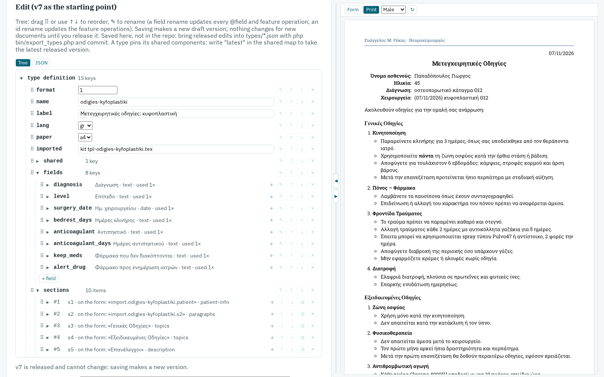

Under **Edit (vN as the starting point)** are two tabs:

- **Tree:** the definition as rows (described below). This is the default.
- **JSON:** the same definition as text.

Both edit the same thing: a change in the tree is in the JSON at once, and the other way round. The browser remembers
which tab you used last.

Between the panes is the **splitter** (see section 6). The preview on the right refreshes about a second after each
change, before anything is saved.

---

## 3. The tree

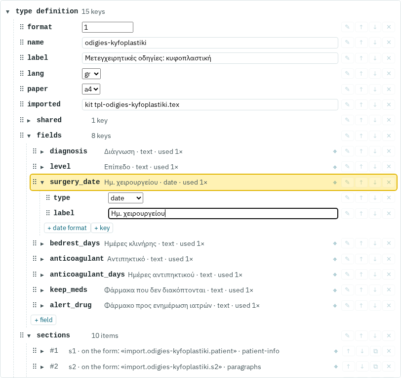

Every key of the definition is a row. A row has, from left to right:

| Part | What it does |
|---|---|
| **⠿** | The drag handle: drag the row onto another row of the same list to move it there. |
| **▸ / ▾** | Open or close a group (an object or a list). Click anywhere on the row's name to toggle it. |
| **Name** | The key (`label`, `fields`, …) or the item's position in a list (`#1`, `#2`, …). |
| **Value or summary** | A text box, a checkbox (yes/no), a number box, or a drop-down for keys with fixed choices (`lang`, `paper`, `layout`, a field's `type`, …). A group shows a summary instead (see below). |
| **⌖** | Highlights this item's text in the preview (section 5). |
| **✎ ↑ ↓ ⧉ ✕** | Rename, move up, move down, duplicate (lists only), delete. They appear clearly when the mouse is over the row. |

Under each open group are **+ key** / **+ item** / **+ field** buttons to add to it. A new list item copies the shape of
the item before it (same keys, empty texts) and gets the next free id. **⧉ Duplicate** makes a copy with new ids.

### Summaries

The summary of a group tells you what it is without opening it:

- **a field:** its label, type, date format (if set) and how many times it is used: `Ημ. χειρουργείου · date · used 1×`;
- **a section:** its id, **the name it has on the input form**, and its layout:
  `s3 · on the form: «Γενικές Οδηγίες» · topics`;
- **a block:** its id, `(off)` if it starts switched off, its choice group if it has one, and the start of its text;
- **a feature operation:** what it does: `enable s2_b2`.

The name a section has on the form is its `label`, else its `heading`, else its `slot`. A section with neither label nor
heading shows its technical slot name (`import.odigies-kyfoplastiki.patient`); give it a `label` for a readable name.

### Renaming: the change follows everywhere

**✎** renames, and the rename is carried to every place that depends on the name:

| You rename | What follows |
|---|---|
| a **field** (a key under `fields`) | every `@field` in every text of the type (whole tokens only: renaming `@f1` leaves `@f10` and an escaped `\@f1` alone), and every case-feature operation that sets it. You are told how many uses change before it happens. |
| a **block, section or topic id** | the case-feature operations that point to it. Ids are read-only boxes: they change only through ✎, so a reference can never break silently. |
| a **choice group** (`✎ all` next to a block's `group`) | the group name in every block of the group. |
| a **shared component** (a key under `shared`) | the sections that use it (`use` / `library`). |

A field name must be lower-case Latin letters, digits and `_`, starting with a letter (it is written `@name` in the
texts), and cannot be one of the built-in values `patient`, `age`, `amka`, `clinic`, `date`.

### Date formats

A date field gets a **+ date format** button (visible in the screenshot under `surgery_date`). The format box offers a
list (`d/m/Y` → 20/02/2026, `j/n/Y` → 20/2/2026, `d-m-Y`, `d.m.Y`, `d/m/y`, `long` → 20 Φεβρουαρίου 2026, …) and
accepts any PHP date pattern. The field's own format is used everywhere the date is printed; a block's `datefmt` only
serves dates that have no format of their own; with neither, dates print as `d/m/Y`.

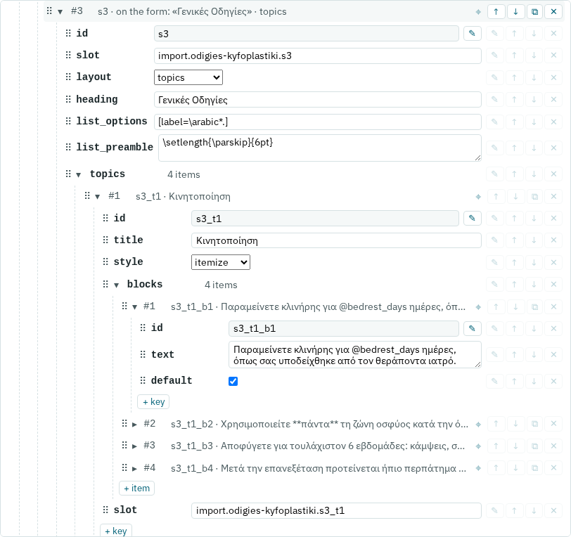

The second tree screenshot shows a `topics` section opened down to its first block: the section's own keys (`id`,
`slot`, `layout`, `heading`, list options), then `topics → #1 → blocks → #1` with the block's `id` (read-only, ✎ to
rename), its `text` (markup: `@field`, `{Ο|Η}`, `**bold**`, …) and `default` (whether it starts switched on). The row
under the mouse (`#3`) shows its tools at full strength.

---

## 4. The preview panel

The bar at the top of the panel:

| Control | What it does |
|---|---|
| **Form** | Shows the input form a document of this type gets. |
| **Print** | Shows what the printed document would contain. |
| **Male / Female** | The sample patient's gender, so every `{Ο|Η}` variant can be checked. |
| **↻** | Refreshes the preview now (it also refreshes on its own after each edit). |

The preview uses **sample values**: each field shows its default, else its placeholder, else its label; a date field
gets a real date (its default, or today) so its format shows; a medication table with no default rows shows two drugs
from the library.

### Print

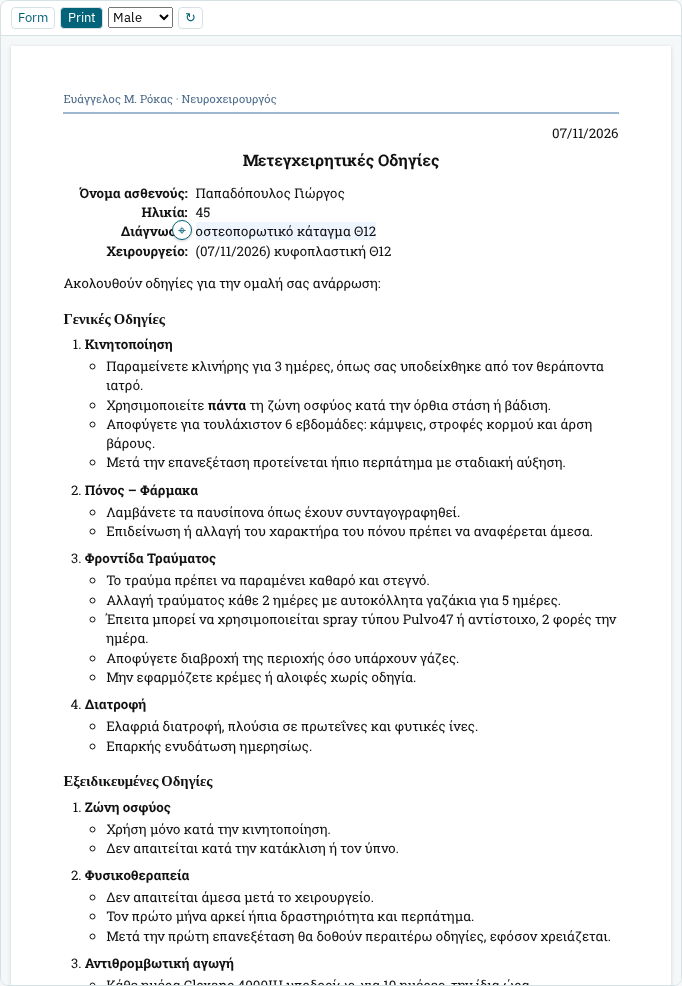

The document as it would print: date, title, the patient box, headings, paragraphs, lists, the emergency box, the
medication table and the closing with the doctor's name. It is produced by the same engine that writes the PDF, turned
into HTML, so the text, the order and what is on or off are exactly the PDF's. The letterhead graphics, the QR code and
the page breaks are not drawn: for those, the PDF of a document stays the reference.

### Form

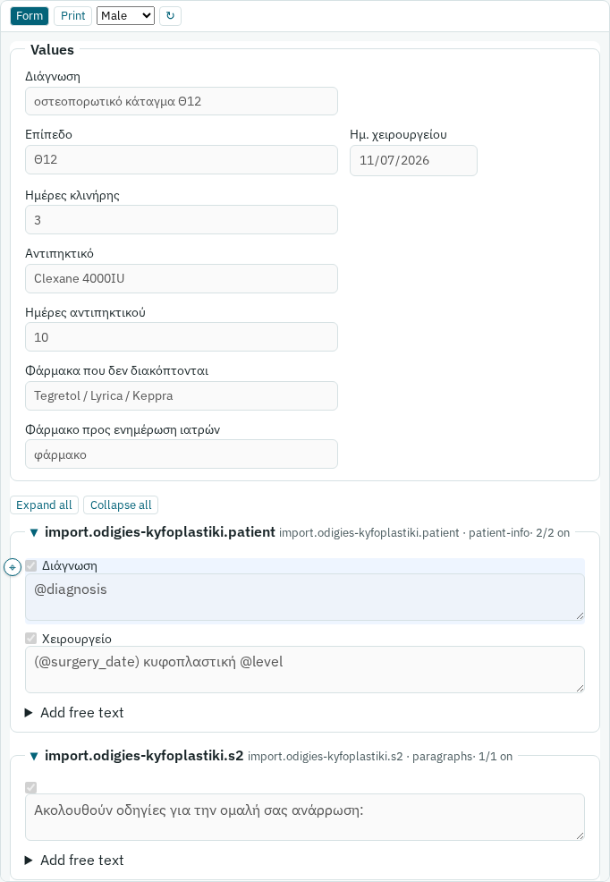

The same form the composer shows when a document of this type is written, greyed out (nothing can be typed here):

- **Values:** one box per field, with its label.
- **Sections:** one box per section, named as on the real form, with its layout and a count of what is switched on
  (`2/2 on`). Click a section's title to fold or unfold it; **Expand all / Collapse all** act on all of them. A section
  that has items to choose from but none switched on starts folded, as it will in the composer.

### Warnings and errors

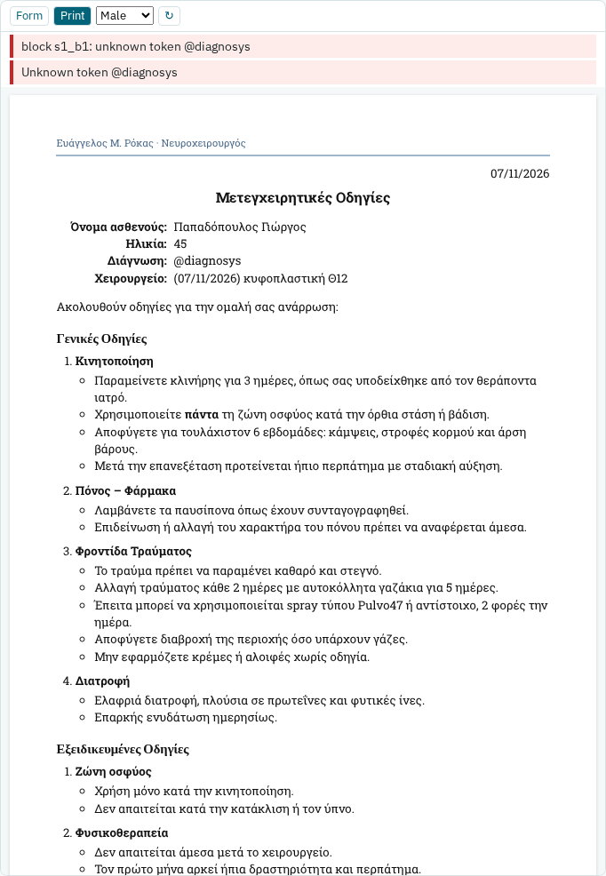

Problems are listed above the preview while you edit. Here `@diagnosis` was mistyped as `@diagnosys`: the preview
names the block and the unknown token, and prints the token as it is so you can find it. Errors that would stop a save
(an unknown token, invalid JSON, a duplicate id, …) are shown in red; if the JSON cannot be read at all, the last good
preview stays visible under the error.

---

## 5. From the preview to the source, and back: ⌖

Every piece of printed text knows where it came from.

- **Preview → editor.** Move the mouse over any text in the preview (Print or Form): a small **⌖** appears beside it.
  Click it, and the editor jumps to the source:
  - in the **Tree** tab, the tree opens down to the item, scrolls to it and highlights it;
  - in the **JSON** tab, the text box puts the cursor on it and selects it.

  In a sentence with a field in it, the field wins: ⌖ on "οστεοπορωτικό κάταγμα Θ12" goes to the field `diagnosis`,
  not to the block around it. Fields, blocks, block labels, section and topic headings, free text, the title and the
  closing can all be located (raw LaTeX blocks that contain lists cannot). Ordinary clicks on the text do nothing, so
  text can still be selected and copied.

- **Editor → preview.** The **⌖** on a tree row highlights that item's text in the preview (switching to Print if the
  form does not show it). If nothing is printed for it with the sample values (for example a block that starts off),
  the panel says so.

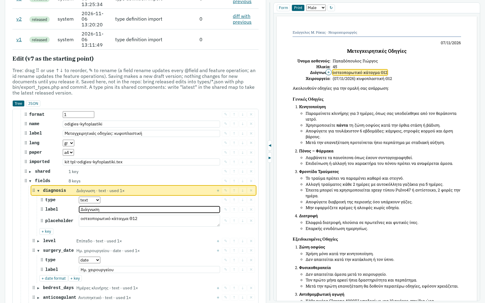

---

## 6. The JSON tab and the splitter

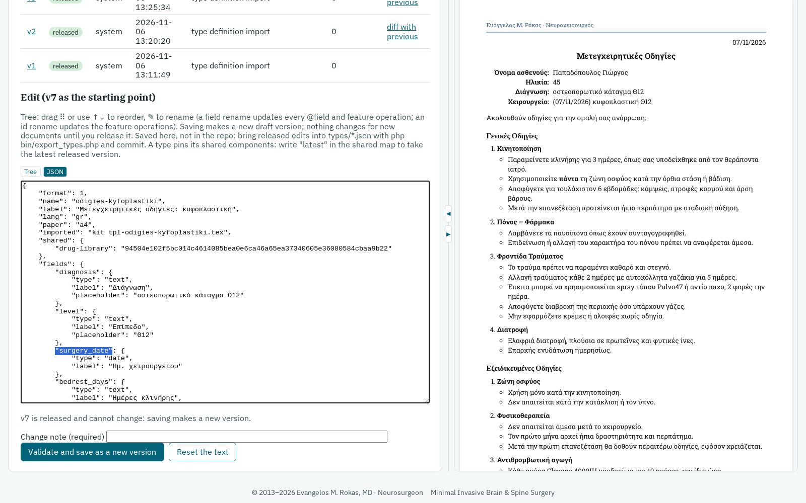

The **JSON** tab shows the definition as text. It is the same definition as the tree; switch back to **Tree** at any
time (if the text has a syntax error, the tree tells you the line and stays closed until it is fixed). ⌖ in the preview
selects the matching part of the text, as in the screenshot.

The **splitter** between the two panes:

- **drag** it to make the preview wider or narrower;
- **◀** widens the preview one step (editor only → both → preview only), **▶** narrows it;
- **double-click** it to go back to the default widths;
- with the splitter focused, the **← / →** keys move it.

The browser remembers the layout.

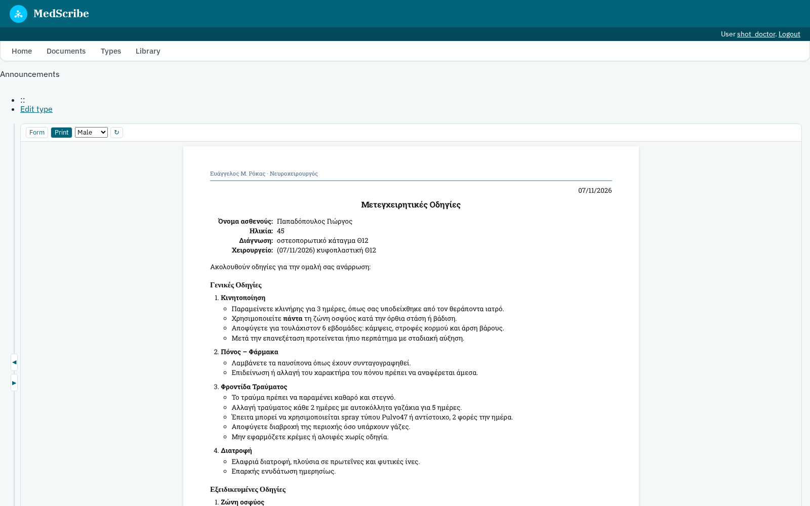

---

## 7. Saving

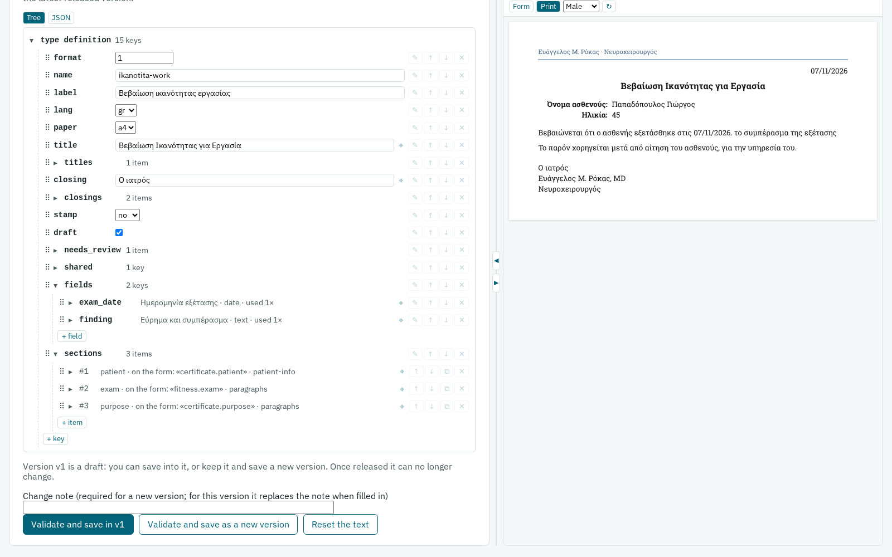

Below the editor:

| Control | When | What it does |
|---|---|---|
| **Change note** | always | A short description of the change. Required for a new version. |
| **Validate and save in vN** | the version shown is the **latest**, still a **draft**, and no document uses it | Saves into that same version (no new version). The note is optional here; when filled in, it replaces the old one. |
| **Validate and save as a new version** | always | Makes a new **draft** version. Nothing changes for new documents until you release it from its **Review & release** page. |
| **Reset the text** | always | Throws away the unsaved edits and reloads the version shown. |

Every save checks the definition first (valid JSON, known layouts, unique ids, no unknown tokens, date formats only on
date fields, …). A refused save keeps your edits on the page, says why it was refused, and shows a notice that the text
is **not saved**.

A **released** version never changes: the page says so and offers only **save as a new version** (as in the
screenshot of section 6, "v7 is released and cannot change").

### The repo files

The editor saves into MedScribe's database, not into the repo's `types/*.json` files. After editing in the browser,
bring the released changes into the files and commit them:

```
php bin/export_types.php --check     # what differs
php bin/export_types.php             # write types/*.json
git diff types/                      # review, then commit
```

(Until that is done, running `bin/import_types.php` for that type would make a new version from the old file.)

---

## 8. Common tasks

| Task | How |
|---|---|
| Rename a field | Tree → `fields` → ✎ on the field. Every `@field` follows. |
| Change how a date prints | Tree → `fields` → the date field → **+ date format** → pick a format. |
| Give a section a readable name on the form | Tree → the section → **+ key** → `label`. |
| Change a sentence | Find it in the preview, ⌖, edit the `text` box that opens. |
| Make a block start switched on or off | The block's `default` checkbox. |
| Offer alternative sentences (only one at a time) | Give the blocks the same `group`. |
| Reorder sections or blocks | Drag ⠿, or ↑ / ↓. |
| Check the female wording | Preview → **Female**. |
| See what the secretary will fill in | Preview → **Form**. |
| Put a change into use | Save as a new version, then **Review & release** it. |
| Keep the change in git | `php bin/export_types.php`, review, commit. |

The full format of a type (every key a section, block or field can have) is in the header comment of `web/render.php`.
